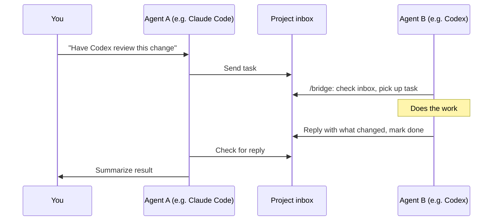

# Agent Bridge

Agent Bridge lets AI coding agents such as Claude Code and Codex hand work to each other directly, so nobody
has to copy prompts between chat windows. One agent sends a task ("implement this", "review this change",
"fix this bug"), another picks it up, does the work, and reports back with what it changed.

Every task is tracked from sent to in progress to done, so it's always clear what is waiting and what is
finished. Any number of agents can join, each under its own name, and each project keeps its own inbox.
There is no server or extra setup: messages are plain files inside the project, and each agent only needs
this skill installed.
