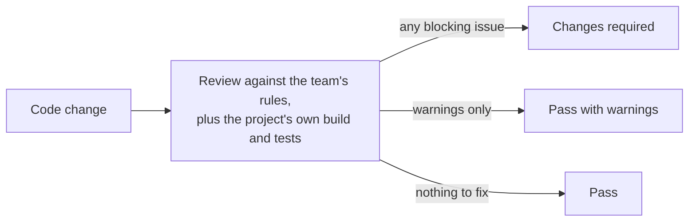

# Code Review

Code Review checks a code change before it merges and tells you, in plain terms, whether it is safe to ship.
Point it at work in progress, a branch, a range of commits or a few files. You get back a short report:
what would break, why it matters, and how to fix it, often with the corrected code ready to apply.

The team's own written standards come first, and only problems the change itself introduces are reported,
so old issues don't pile up in the review. The verdict is worked out from how serious the issues are,
never picked by gut feel. Reports come in the reader's language, and
the skill never posts, approves, merges or edits code on its own. A person always makes the final call.
