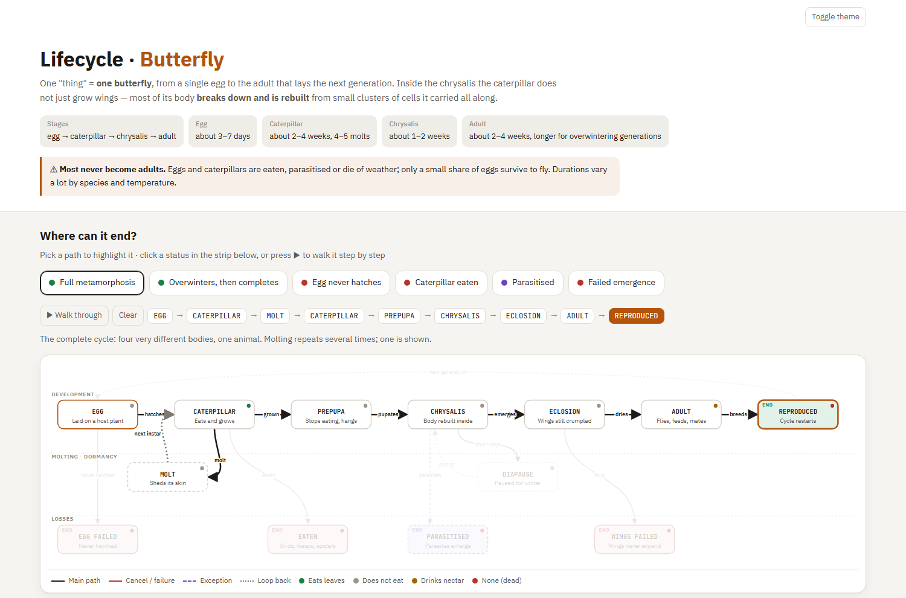

# Lifecycle Diagram

Lifecycle Diagram turns "what statuses can this thing be in?" into one interactive web page. Give it any
entity that moves through statuses, such as orders, payments, tickets, subscriptions or deployments, and it
maps every status, every way to move between them and every way it can end.

*Real output: the lifecycle of a butterfly, with the "Full metamorphosis" path highlighted.
[Open the interactive page](https://htmlpreview.github.io/?https://github.com/modmastei2/agent-kit/blob/master/lifecycle-diagram/examples/butterfly.html).*

Readers click a status to see what it means and what happens next, or pick an outcome to walk the path
that leads there step by step. Every fact is tagged with how sure it is, so guesses never pass as truth.
The page is a single file in the reader's language that opens in any browser. For software, each status
can also show the API calls and events involved, and one entity can be compared across several providers.
