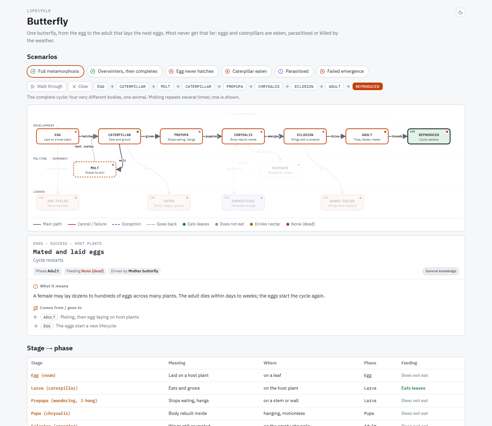

# Lifecycle Diagram

Lifecycle Diagram turns "what statuses can this thing be in?" into one interactive web page. Give it any
entity that moves through statuses, such as orders, payments, tickets, subscriptions or deployments, and it
maps every status, every way to move between them and every way it can end.

*Real output: the lifecycle of a butterfly, with the "Full metamorphosis" scenario highlighted.
[Open the interactive page](https://htmlpreview.github.io/?https://github.com/modmastei2/agent-kit/blob/master/skills/engineering/lifecycle-diagram/examples/butterfly.html).*

Readers click a status to light it up with everything connected to it and read what it means, or pick a
scenario to trace the path that leads to an ending, step by step. Every fact is tagged with how sure it is,
so guesses never pass as truth. The page is a single file in the reader's language, written plainly with
codes and names kept as they are, and opens in any browser. Its content is plain data with automatic
placement, so a new status is one entry, not hand-written HTML. For software, each status can also show the
API calls and events involved, and one entity can be compared across several providers.
